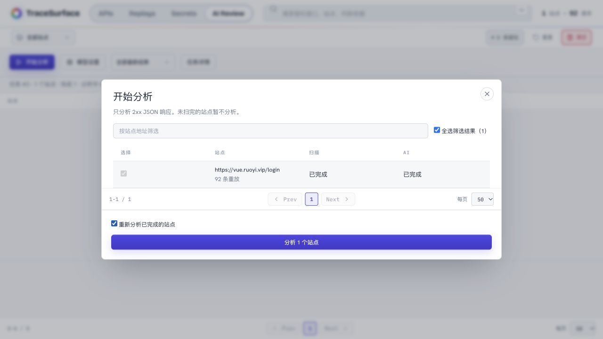
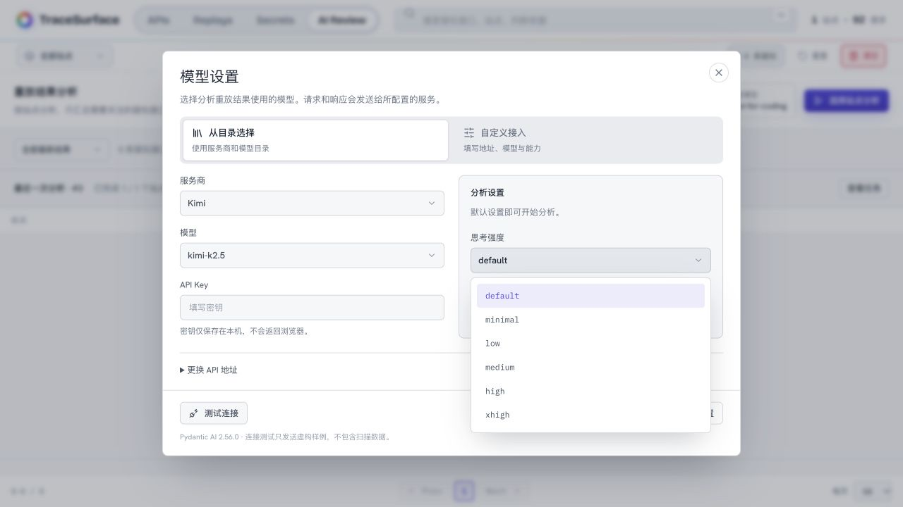
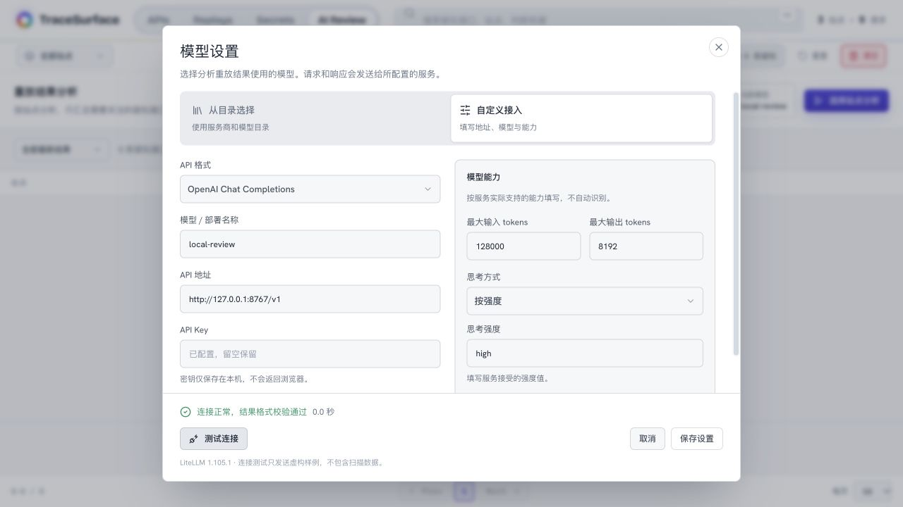
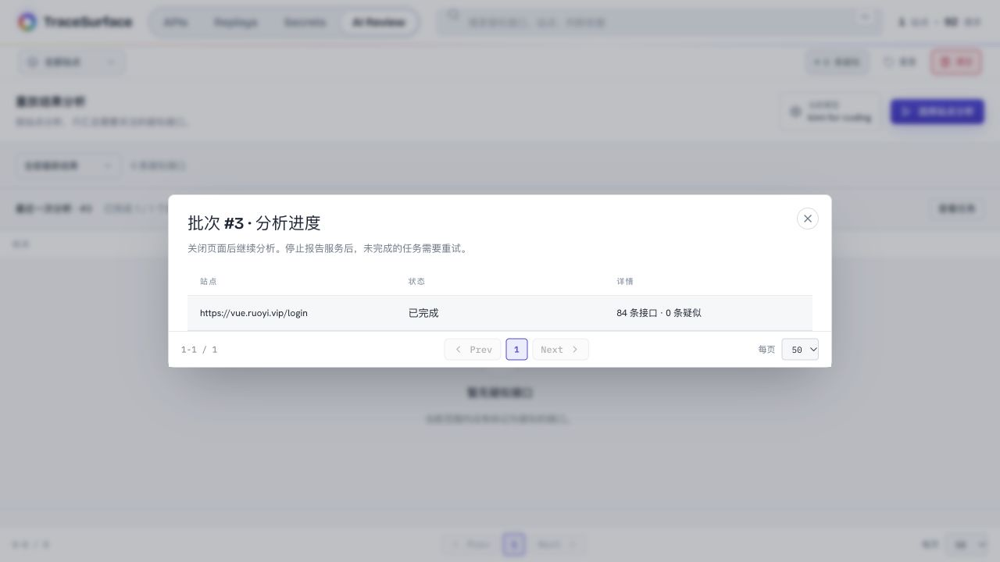
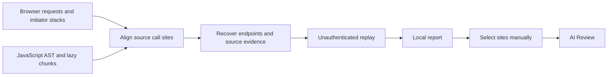

<div align="center">

# TraceSurface

**Recover APIs from frontend code. Review what their responses actually reveal.**

Browser tracing · JavaScript AST analysis · Unauthenticated replay · AI Review

[Download](https://github.com/pis10/TraceSurface/releases/latest) · [Quick Start](#quick-start) · [AI Review](#ai-review) · [Example](#example) · [简体中文](./README.md)

[](https://github.com/pis10/TraceSurface/releases/latest)
[](https://github.com/pis10/TraceSurface/actions/workflows/release.yml)
[](./LICENSE)

</div>

Give TraceSurface a URL. It traces real browser requests and parses entry scripts and lazy chunks to recover APIs the current page never called. It then replays requests without browser authentication and brings their source evidence, requests, and responses into one local report.

For larger scans, select sites for **AI Review**. Suspected issues from every site appear in one list, with explanations and original traffic for manual verification.


## Capabilities

| From discovery to review | What TraceSurface provides |
| --- | --- |
| Find untriggered endpoints | Parse fetch, XHR, axios, custom wrappers, and webpack / Vite lazy chunks |
| Recover complete URLs | Align browser requests and initiator stacks with source locations to infer base URLs and retain evidence grades |
| Inspect unauthenticated responses | Replay without loading browser Cookie, Authorization, or other authentication headers |
| Focus review on suspected issues | Read replay results by site with AI and collect findings and verification suggestions in one view |
| Inspect the evidence | Explore API origins, response bodies, and sensitive information found in frontend assets |

## Quick Start

Download and extract the archive for your platform from [Releases](https://github.com/pis10/TraceSurface/releases/latest). Python is not required:

| Platform | Archive |
| --- | --- |
| Windows x86_64 | `tracesurface-windows-x86_64.zip` |
| macOS Apple Silicon | `tracesurface-macos-arm64.tar.gz` |
| Linux x86_64 | `tracesurface-linux-x86_64.tar.gz` |

```bash
# macOS / Linux
./tracesurface scan https://target.example
./tracesurface serve
```

```powershell
# Windows PowerShell
.\tracesurface.exe scan https://target.example
.\tracesurface.exe serve
```

Open **http://127.0.0.1:8765**. TraceSurface uses your installed Google Chrome when available, or downloads Chromium on the first scan.

> [!IMPORTANT]
> **Upgrading to v1.4: older data and AI configuration formats are incompatible. No migration is provided.** Keep your old directory and select a fresh one with `TRACESURFACE_HOME`, then rescan. Existing data is never converted or deleted automatically.

<details>
<summary>Use a new data directory</summary>

macOS / Linux, run both scanning and the report service in the same terminal:

```bash
export TRACESURFACE_HOME="$HOME/.tracesurface-v1.4"
./tracesurface scan https://target.example
./tracesurface serve
```

Windows PowerShell:

```powershell
$env:TRACESURFACE_HOME = "$env:USERPROFILE\.tracesurface-v1.4"
.\tracesurface.exe scan https://target.example
.\tracesurface.exe serve
```

</details>

<details>
<summary>Run from source</summary>

Requires Python 3.12+ and [uv](https://docs.astral.sh/uv/).

```bash
git clone https://github.com/pis10/TraceSurface.git
cd TraceSurface
uv sync --locked
uv run tracesurface scan https://target.example
uv run tracesurface serve
```

Built report assets are included. After editing the frontend, run `npm ci` and `npm run build` inside `frontend/`.

</details>

## AI Review

**Scan first. Choose when and what to analyze.** Review multiple sites without opening a separate report for each one.

1. Open **AI Review → 模型设置 (Model settings)**, select a provider and model, and enter an API key.
2. Use **测试连接 (Test connection)** to verify the connection and result format, then save.
3. Open **选择站点分析 (Select sites)** and select individual sites or every site matching the filter.
4. Review suspected endpoints in one list. Open an item to inspect its original request, response, and verification suggestions.



Each site is analyzed independently using the existing **2xx + JSON** replay filter. Unfinished scans are skipped until you start analysis again after completion. Sites with no eligible responses do not call the model. Closing the page keeps jobs running; stopping the report server interrupts unfinished jobs, which can be retried manually.

### Connect your model

The built-in catalog comes from [Pydantic AI](https://ai.pydantic.dev/) and includes DeepSeek, Kimi, GLM, Alibaba, OpenAI, Anthropic, Gemini, and other providers. Search the catalog or enter a model ID that has not yet been listed. Catalog models do not require manually declared context limits.



Choose **自定义接入 (Custom connection)** for your own compatible service. Supported APIs are OpenAI Chat Completions, OpenAI Responses, Anthropic Messages, and Gemini generateContent. Enter the endpoint, model ID, API key, context window, and maximum output, then check the reasoning effort levels your service supports.

The **默认强度 (Default effort)** selector determines the effort used for analysis. For example, checking `low / high / max` and selecting `high` sends `high` for each analysis. `default` leaves effort unspecified so the service decides. Catalog models use SDK mappings; the effect of each level can vary by model.

<details>
<summary>Custom connection example</summary>



The endpoint and model ID shown are examples. Use the values supplied by your service.

</details>

Scanning and replay do not require AI. Scan traffic is sent to your configured model service only when you start analysis; connection tests use synthetic samples. API keys are stored locally and are not returned to the page. AI findings are leads for manual review. An empty findings list does not prove a site is secure; task details show whether analysis completed.

## Example

Scan the public RuoYi demo login page to discover frontend API references without logging into the admin interface:

```bash
tracesurface scan https://vue.ruoyi.vip/login --no-auth
```

The captcha request provides the `/prod-api` prefix and its source location. TraceSurface aligns the runtime request with a JavaScript call site, then expands the business code to find role, menu, department, dictionary, and monitoring endpoints.

| Example scan | Count |
| --- | ---: |
| AST call sites, before deduplication | 316 |
| Requests replayed | 92 |
| Responses matching 2xx + JSON | 84 |

Many responses return HTTP 200 while explicitly reporting `code: 401` in the body. **Discovering an endpoint or receiving a 200 response does not establish a vulnerability.** In this example, AI reviewed all 84 eligible replay results and flagged no suspected issues.



## Common Workflows

| Task | Command |
| --- | --- |
| Discover APIs without active replay | `tracesurface scan https://target.example --no-replay` |
| Scan a list with up to 10 sites at once | `tracesurface scan -f targets.txt -s 10` |
| Interact with a visible browser | `tracesurface scan https://target.example --headed --wait-ms 15000` |
| Save browser authentication for collection | `tracesurface login https://sso.example.com` |
| Collect without saved authentication | `tracesurface scan https://target.example --no-auth` |
| Start the local report | `tracesurface serve` |

Run `tracesurface scan --help` for all options. Data is stored in `~/.tracesurface/` by default. Rescanning a site replaces its previous scan and associated AI results.

The report has four views: **APIs** for endpoints and source evidence, **Replays** for replay traffic, **Secrets** for frontend sensitive-information matches, and **AI Review** for suspected issues.

## How It Works



<details>
<summary>API evidence grades</summary>

| Grade | Meaning |
| --- | --- |
| **runtime** | The browser issued this request |
| **full-url** | Source code contains a complete URL |
| **L1** | A path binds uniquely to a known base URL |
| **L2** | Bound through client relationships or fan-out |
| **L3** | Uses a global base URL discovered in the scan |
| **L4** | Falls back to the target origin |
| **no-url** | A call site exists, but a complete URL is not yet available |

These grades describe URL evidence and inference, not vulnerability severity.

</details>

Built with Python, Playwright/CDP, tree-sitter, SQLite, FastAPI, React, and Pydantic AI.

## Authorized Use

Scan only targets you own or are authorized to assess. Replay actively sends GET and POST requests by default; other methods require `--allow-destructive`. URLs and request bodies may themselves carry credentials, so inspect the actual traffic during review.

[MIT License](./LICENSE)
