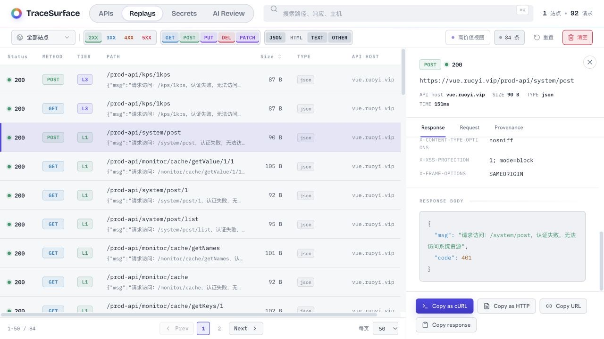
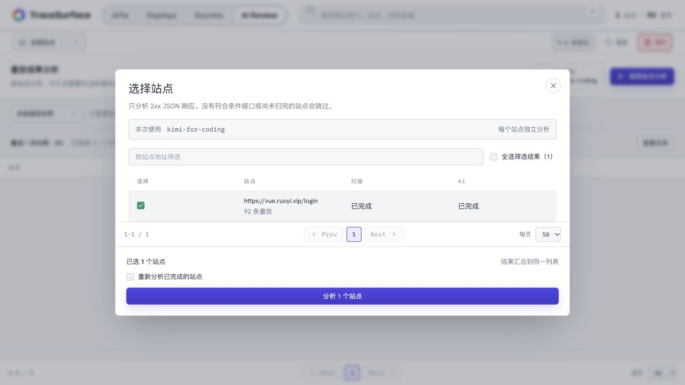
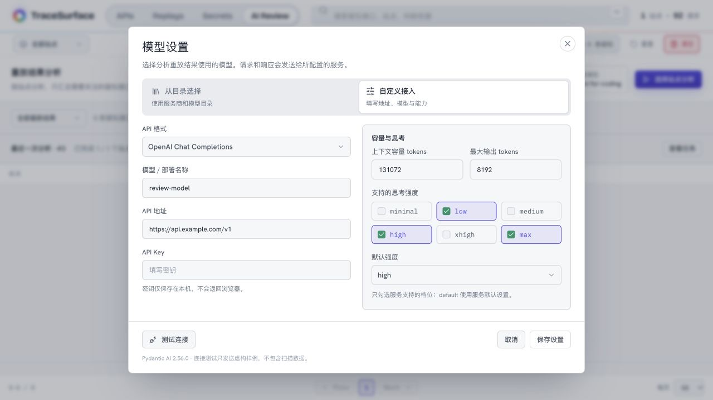
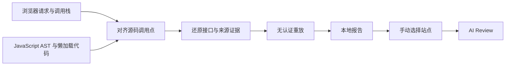

<div align="center">

# TraceSurface

**从前端还原 API，用真实响应判断哪些接口值得关注。**

浏览器追踪 · JavaScript AST 分析 · 无认证重放 · AI Review

[下载](https://github.com/pis10/TraceSurface/releases/latest) · [快速开始](#快速开始) · [AI Review](#ai-review) · [实战示例](#实战示例) · [English](./README.en.md)

[](https://github.com/pis10/TraceSurface/tree/v1.4.0)
[](https://github.com/pis10/TraceSurface/actions/workflows/release.yml)
[](./LICENSE)

</div>

给 TraceSurface 一个 URL，它会追踪页面真实发出的请求，解析入口脚本与懒加载代码，找回当前页面没有触发的 API。随后进行无认证重放，把接口来源、请求与响应放进同一份本地报告。

接口多时，可以手动选择站点交给 **AI Review** 分析。所有站点的疑似接口集中呈现，保留判断依据和原始报文，方便逐项复核。



## 能做什么

| 从发现到复核 | TraceSurface 提供的能力 |
| --- | --- |
| 发现未触发的接口 | 解析 fetch、XHR、axios、自定义封装，以及 webpack / Vite 懒加载代码 |
| 还原完整地址 | 用浏览器请求和调用栈对齐源码位置，推导 baseURL，并保留证据层级 |
| 查看无认证响应 | 重放请求时不加载浏览器 Cookie、Authorization 等认证头 |
| 汇总需要关注的接口 | AI 按站点阅读重放结果，跨站点展示疑似问题与验证建议 |
| 回到原始证据 | 在本地报告中检查 API 来源、响应正文与前端敏感信息命中 |

## 快速开始

从 [Releases](https://github.com/pis10/TraceSurface/releases/latest) 下载并解压对应平台的文件，无需安装 Python：

| 平台 | 下载文件 |
| --- | --- |
| Windows x86_64 | `tracesurface-windows-x86_64.zip` |
| macOS Apple Silicon | `tracesurface-macos-arm64.tar.gz` |
| Linux x86_64 | `tracesurface-linux-x86_64.tar.gz` |

```bash
# macOS / Linux
./tracesurface scan https://target.example
./tracesurface serve
```

```powershell
# Windows PowerShell
.\tracesurface.exe scan https://target.example
.\tracesurface.exe serve
```

打开 **http://127.0.0.1:8765** 查看报告。扫描优先使用本机 Google Chrome；没有 Chrome 时，会自动下载 Chromium。

<details>
<summary>从源码运行</summary>

需要 Python 3.12+ 和 [uv](https://docs.astral.sh/uv/)。

```bash
git clone https://github.com/pis10/TraceSurface.git
cd TraceSurface
uv sync --locked
uv run tracesurface scan https://target.example
uv run tracesurface serve
```

仓库包含报告页面的构建产物。修改前端后，在 `frontend/` 中运行 `npm ci` 和 `npm run build`。

</details>

## AI Review

**扫描由工具完成，分析由你决定何时开始。** 不需要为每个站点单独打开一份报告。

1. 打开 **AI Review → 模型设置**，选择服务商与模型，填写 API Key。
2. 点击 **测试连接**，确认模型能够返回所需的分析结果，再保存设置。
3. 点击 **选择站点分析**，勾选站点，或选择筛选结果中的全部站点。
4. 在同一列表查看疑似接口；打开详情，结合原始请求、响应与验证建议复核。



每个站点独立分析，只读取已有的 **2xx + JSON** 重放结果。尚未扫完的站点会提示扫描完成后再分析；没有符合条件的接口时不调用模型。关闭网页不会停止后台任务；停止报告服务后，未完成的任务需要手动重试。

### 接入你的模型

内置目录由 [Pydantic AI](https://ai.pydantic.dev/) 提供，包含 DeepSeek、Kimi、GLM、阿里百炼、OpenAI、Anthropic、Gemini 等服务商。可以搜索模型，也可以输入目录尚未收录的型号。内置模型不需要手工填写上下文容量。


有自己的兼容服务时，选择 **自定义接入**。支持 OpenAI Chat Completions、OpenAI Responses、Anthropic Messages 和 Gemini generateContent 四种 API 格式。填写服务地址、模型名称、API Key、上下文容量与最大输出，再勾选服务支持的思考强度。

分析与连接测试使用同一套结果校验：提示词包含完整输入/输出示例，兼容 JSON 外的代码块、说明文字和已结束的 `<think>` 内容；字段或接口编号不合格时最多自动纠错三次（含首次共四次请求，仍受总超时限制）。所有接口均通过校验后才保存成功。若提示输出被截断，请增大最大输出或降低思考强度；网络、认证和截断错误不会自动重复请求。

页面中的“默认强度”就是分析实际使用的档位：例如勾选 `low / high / max` 后选中 `high`，分析便使用 `high`。`default` 表示不指定强度，由服务决定；内置模型的档位转换由 SDK 处理，不同型号的实际效果可能不同。

<details>
<summary>查看自定义接入示例</summary>



示例地址与模型名仅用于说明表单，请按服务商提供的信息填写。

</details>

扫描与重放不依赖 AI。只有主动发起分析，扫描报文才会发送至所配置的模型服务；连接测试只发送虚构样例。API Key 保存在本机，不回传页面。AI 结论用于辅助人工复核；没有疑似结果不代表站点不存在漏洞，任务详情会显示分析是否完成。

## 实战示例

以若依公开演示站的登录页为例，无需登录后台即可从前端代码发现接口：

```bash
tracesurface scan https://vue.ruoyi.vip/login --no-auth
```

登录页的验证码请求提供了 `/prod-api` 前缀与调用位置。TraceSurface 将运行时请求对齐到 JavaScript 调用点，再继续展开业务代码，发现角色、菜单、部门、字典和监控等接口。

| 示例扫描 | 数量 |
| --- | ---: |
| AST 调用点（去重前） | 316 |
| 重放请求 | 92 |
| 符合 2xx + JSON 的响应 | 84 |

这些接口中的许多响应虽然是 HTTP 200，正文却明确返回 `code: 401`。**发现接口、收到 200，都不等于发现漏洞。** 在这次示例中，AI 完整分析了 84 条重放结果，没有标记疑似接口。


## 常见用法

| 场景 | 命令 |
| --- | --- |
| 只发现接口，不主动重放 | `tracesurface scan https://target.example --no-replay` |
| 批量扫描，最多同时处理 10 个站点 | `tracesurface scan -f targets.txt -s 10` |
| 显示浏览器，手动操作页面 | `tracesurface scan https://target.example --headed --wait-ms 15000` |
| 保存浏览器登录态供采集使用 | `tracesurface login https://sso.example.com` |
| 采集时也不使用已保存的登录态 | `tracesurface scan https://target.example --no-auth` |
| 启动本地报告 | `tracesurface serve` |

运行 `tracesurface scan --help` 查看完整参数。数据默认保存在 `~/.tracesurface/`；重新扫描同一站点会替换该站点的旧扫描及关联的 AI 结果。

报告分为 **APIs**（接口与来源）、**Replays**（重放报文）、**Secrets**（前端敏感信息命中）和 **AI Review**（疑似接口汇总）。

## 工作原理



<details>
<summary>接口的证据层级</summary>

| 层级 | 含义 |
| --- | --- |
| **runtime** | 浏览器实际发出过请求 |
| **full-url** | 源码中已有完整 URL |
| **L1** | 路径可唯一绑定到已知 baseURL |
| **L2** | 通过 client 关系或扇出绑定 |
| **L3** | 使用本轮扫描发现的全局 baseURL |
| **L4** | 使用目标站点 origin 兜底 |
| **no-url** | 发现调用点，但尚未还原出完整 URL |

证据层级描述接口地址的来源与推导依据，不表示漏洞风险等级。

</details>

基于 Python、Playwright/CDP、tree-sitter、SQLite、FastAPI、React 与 Pydantic AI 构建。

## 使用范围

仅扫描你拥有或已获授权的目标。默认重放会主动发送 GET 和 POST；其他方法需要显式启用 `--allow-destructive`。URL 或请求体本身可能携带凭据，复核时仍需检查实际报文。

[MIT License](./LICENSE)
